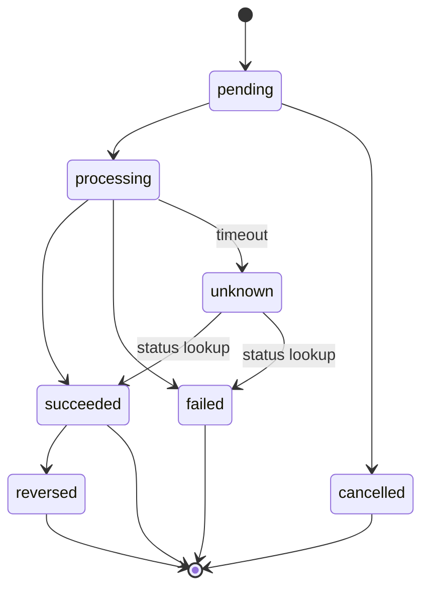
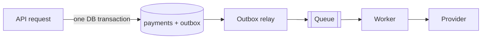
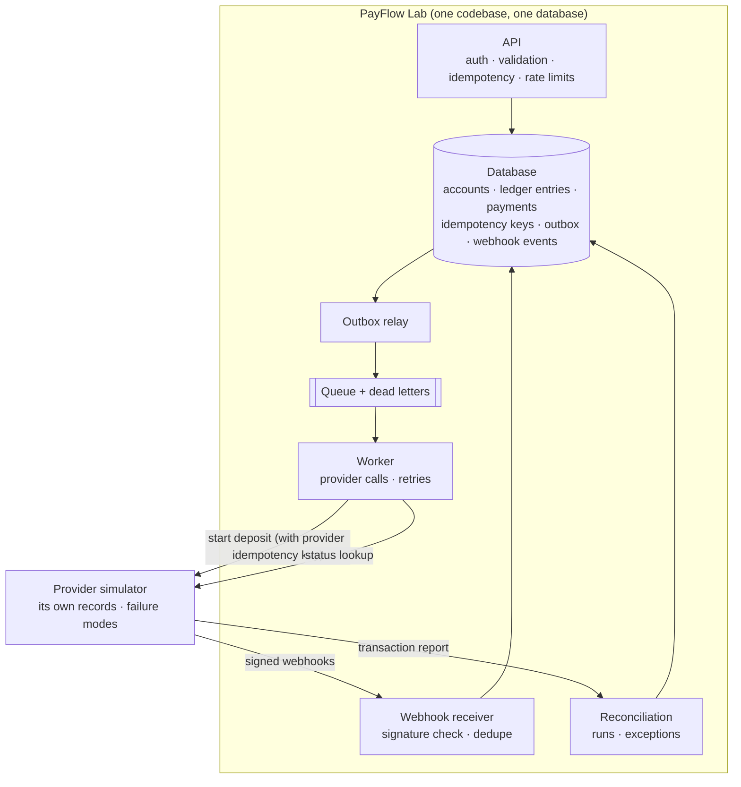

# PayFlow Lab: the backend concepts, and how they fit together

You already know fintech from the frontend side: you've built the screens that show a pending transfer, you've disabled a submit button so nobody pays twice, and you've drawn a spinner while a payment provider made up its mind. This guide is the other side of those screens. It explains each backend concept in plain words, shows where it lives in PayFlow Lab, and ties it to the feature in [the scope](../scope/scope.md) that teaches it.

You can read it straight through once, then come back to a single section when you start the feature it belongs to.

---

## 1. The one idea behind everything

On the frontend, a bug usually means a wrong screen. You fix it and refresh. On a payments backend, a bug can mean money created from nothing, money spent twice, or money that vanished. And refreshing doesn't fix it, because the record is already written.

So every concept here answers one question:

> **How does the system stay correct when several things go wrong at once?**

These are the things that go wrong, and they happen far more often than you'd guess:

* A client sends the same request twice (a double tap, a mobile retry, a timeout).
* Two requests touch the same balance at the same moment.
* The server crashes halfway through a piece of work.
* An outside provider is slow, times out, says "yes" twice, or tells you things in the wrong order.
* Your records and the provider's records quietly drift apart.
* Someone (or a bug) floods you with traffic.

Each concept below is a tool against one or more of these. No single tool covers all of them, which is why a real system layers them.

---

## 2. Concept map: what teaches what

| Concept | The failure it protects you from | Where you learn it (scope #) |
|---|---|---|
| Money as integers | Rounding errors that create or lose kobo | 3 |
| Database transactions | Half finished writes | 3, 5 |
| Concurrency control | Two requests spending the same balance | 5 |
| Double entry ledger | Money appearing or vanishing with no trace | 3, 4, 5 |
| Idempotency | The same request moving money twice | 6 (and again in 9, 11) |
| Payment state machine | Payments in impossible or regressed states | 7 |
| Webhooks | Not hearing about outcomes, or trusting fake ones | 8, 9 |
| Unknown outcomes | Treating a timeout as a failure and paying twice | 9, 10 |
| Distributed transactions (the lack of them) | Assuming you can "roll back" the outside world | 9, 10, 13 |
| Queues and workers | Slow work blocking requests; lost work on crash | 11 |
| Retries, backoff, dead letters | Giving up too early, or retrying an outage to death | 12 |
| Transactional outbox | Saving a payment but losing its event (or the reverse) | 11 |
| Event driven architecture | Tight coupling between parts that should work alone | 11, 16 |
| Sagas and compensation | Multi step flows that fail halfway | 10, 14 |
| Reconciliation | Your system and the provider disagreeing | 13, 14 |
| Rate limiting | Floods of traffic exhausting the system | 15 |
| Observability | Problems you can't see until a customer complains | 16 |

---

## 3. The money core

### 3.1 Money as integers (minor units)

**What it is.** You store amounts as whole numbers of the smallest unit of the currency. ₦10,000.50 is stored as `1000050` kobo. You always store the currency next to it (`NGN`).

**Why it matters.** Computers store decimals like `0.1` in floating point, which can't represent most decimal fractions exactly. You've probably seen `0.1 + 0.2 === 0.30000000000000004` in JavaScript. On a screen that's a cosmetic bug. In a ledger, adding that tiny error up over millions of rows means your books don't balance.

**In PayFlow Lab.** Every amount column is an integer in kobo (or an exact decimal type, if `/architect` picks that). The API also accepts and returns integers, so nothing ever passes through a float. Formatting `1000050` as "₦10,000.50" is a display concern, the part you already know well.

**Common mistake.** Converting to a float "just for the calculation" (for example, to work out a 1.5% fee). Do fee math in integers and pick an explicit rounding rule.

### 3.2 Database transactions

**What it is.** A database transaction is a group of writes that the database treats as one unit: either all of them are saved, or none are. You start it (`BEGIN`), do your writes, and `COMMIT`. If anything fails in between, you `ROLLBACK` and the database looks as if you never started.

This is the "A" (atomicity) in **ACID**:

* **Atomic**: all or nothing.
* **Consistent**: rules (constraints) hold before and after.
* **Isolated**: concurrent transactions don't see each other's half done work (how strictly depends on the *isolation level*).
* **Durable**: once committed, it survives a crash.

**Frontend analogy.** Think of a form wizard where nothing is saved until the final "Submit". If the user closes the tab on step 3, nothing is half saved. A transaction gives you that guarantee for database writes.

**In PayFlow Lab.** A transfer writes a ledger transaction row, two ledger entry rows, and maybe updates two cached balances. All of that happens in one database transaction. If the server dies after writing one entry, the rollback means there is never a debit without its matching credit.

**The limit you must remember.** A database transaction only covers *your* database. It can't include a call to the payment provider. More on that in [5.3](#53-distributed-transactions-and-why-you-cant-have-one).

### 3.3 Concurrency control

**What it is.** The rules that stop two things running at the same time from corrupting shared data.

**The classic bug (a race condition).** Alice has ₦10,000. Two transfer requests of ₦7,000 arrive at the same moment:

```
Request A: read balance → 10,000   ✔ enough
Request B: read balance → 10,000   ✔ enough
Request A: write balance = 3,000, post entries
Request B: write balance = 3,000, post entries
```

Alice sent ₦14,000 from a ₦10,000 balance. Each request was "correct" alone; together they broke the system. This is called a *lost update*, or *check then act*.

**Frontend analogy.** It's the same family as a stale closure in React, or two `setState` calls that both read an old value. The difference is that here the stale read moves real money.

**The tools, from simplest to most general:**

1. **Row locking.** Read the wallet with `SELECT ... FOR UPDATE`. The database locks that row, so request B waits until A commits, then reads the *new* balance (3,000) and is correctly rejected.
2. **Conditional update.** Do the check and the write in one statement: `UPDATE wallets SET balance = balance - 7000 WHERE id = $1 AND balance >= 7000`. If zero rows changed, the money wasn't there.
3. **Constraints as a safety net.** A `CHECK (balance >= 0)` constraint means even buggy code can't push a balance negative. The database refuses.
4. **Stricter isolation.** The `SERIALIZABLE` isolation level makes the database detect these conflicts itself and fail one transaction, which you then retry.

**In PayFlow Lab.** Feature 5 makes you pick one of these approaches (that's an `/architect` decision) and prove it with a test that fires concurrent requests. Write that test *before* the fix and watch it fail. That moment teaches more than any article.

**Bonus trap: deadlocks.** If transfer A locks Alice then Bob, and transfer B locks Bob then Alice, each waits for the other forever. The usual fix is to always lock rows in the same order (for example, by wallet id).

### 3.4 Double entry ledger

**What it is.** The accounting method banks have used for centuries. Every movement of money is recorded as at least two **entries** that balance: whatever leaves one account arrives in another. Money is never created or destroyed inside the ledger, only moved.

**The three building blocks:**

* **Account**: a bucket that holds value. Some belong to users (Alice's wallet), some to the platform (cash held at the provider, fees earned, money in flight).
* **Ledger transaction**: one business event ("Alice sent Bob ₦3,000"). It groups the entries.
* **Ledger entry**: one line that moves an amount into or out of one account. Entries are **immutable**: never updated, never deleted.

**Debits and credits, in plain words.** Every entry is either a debit or a credit. For each transaction, total debits must equal total credits. Whether a debit *increases* or *decreases* an account depends on the account type:

* **Asset** accounts (things the platform owns, like cash at the provider): debit increases, credit decreases.
* **Liability** accounts (things the platform owes, like a user's wallet, because that money belongs to the user): credit increases, debit decreases.

If that feels backwards, you're not alone. A simpler way to hold it in your head: give each entry a signed amount, and **the entries in every transaction must sum to zero**. Many engineering ledgers work exactly this way.

**The Phase 1 exercise as a ledger:**

| Transaction | Account | Debit | Credit |
|---|---|---|---|
| Alice deposits ₦10,000 | Cash at provider (asset) | 10,000 | |
| | Alice wallet (liability) | | 10,000 |
| Bob deposits ₦2,000 | Cash at provider (asset) | 2,000 | |
| | Bob wallet (liability) | | 2,000 |
| Alice sends Bob ₦3,000 | Alice wallet | 3,000 | |
| | Bob wallet | | 3,000 |

Alice's balance is credits minus debits on her account: 10,000 − 3,000 = ₦7,000. Bob's: 2,000 + 3,000 = ₦5,000. The two wallets still total ₦12,000, matching the ₦12,000 of cash the platform holds. That match is the whole point: **the books prove themselves**.

**Derived balances.** A balance is not a number you edit; it's the *sum of entries*. You may keep a cached `balance` column for speed, but you update it in the same transaction as the entries, and you can always rebuild it from entries to check it.

**Why immutability.** If an entry is wrong, you don't edit it. You post a new **reversing** transaction. That way the history shows what happened and when it was corrected: the audit trail. Editing history in a ledger is how fraud hides.

**Frontend analogy.** It's like the event log behind a Redux store: the state (balance) is derived by replaying actions (entries), and you never mutate past actions.

**In PayFlow Lab.** Feature 3 designs the model; features 4 and 5 are the first to post through it. Every later feature (deposits, withdrawals, fees, reversals) is just another pattern of balanced entries. If you get one thing deeply right in this project, make it this.

---

## 4. Correctness under retries

### 4.1 Idempotency

**What it is.** An operation is **idempotent** if doing it many times has the same effect as doing it once. "Set the light to on" is idempotent. "Toggle the light" is not. "Send Bob ₦3,000" is *not* naturally idempotent, so you have to make it so.

**Why you need it.** The client sends a transfer, then the network drops before the response arrives. The client has no idea whether the money moved. The only safe thing it can do is retry. Without idempotency, that retry moves the money a second time.

**Frontend analogy.** Disabling the pay button after one click is a frontend form of idempotency. But it can't protect against a network retry, a mobile app resending in the background, or a second tab. The real guarantee has to live on the server.

**How it works (the `Idempotency-Key` pattern used by real payment APIs):**

1. The client generates a unique key (usually a UUID) for one *intent* ("this transfer") and sends it in the `Idempotency-Key` header. Retries of the same intent reuse the same key.
2. The server stores a record: `(user_id, key)` with a unique constraint, a hash of the request body, a status (`in_progress` or `completed`), and the saved response.
3. On each request:
   * **New key**: insert the record as `in_progress`, do the transfer, save the response, mark `completed`.
   * **Same key, same body, completed**: return the saved response. Don't run anything.
   * **Same key, same body, still in progress**: another copy is running right now. Reply "conflict, try again shortly" (often HTTP 409).
   * **Same key, different body**: the client is misusing the key. Reject it (often HTTP 422). Never silently change the original transfer.

**The subtle part: simultaneous duplicates.** If ten copies arrive at once, they can all check "does this key exist?" before any of them inserts it. That's the race condition from 3.3 again. The fix is to let the database's **unique constraint** decide: exactly one insert wins, the rest get a conflict error. Ideally the idempotency record and the transfer are written in the same database transaction, so you can never have one without the other.

**Scope.** Keys are scoped per user (Alice's key "abc" and Bob's key "abc" are different) and usually expire after a period such as 24 hours.

**Where else it appears.** Idempotency isn't only for your API. Your webhook handler must be idempotent (9). Your queue consumers must be idempotent (11). When you call the provider, you send *it* an idempotency key too, so your retries don't double charge on their side.

### 4.2 Payment states (the state machine)

**What it is.** A payment isn't just "done" or "not done". It moves through states, and only certain moves are allowed. A **state machine** writes those rules down explicitly:



(`unknown` is one option for representing a timed out call; `/architect` may instead keep it as `processing` with a flag. The point is to name it.)

**Terminal states** (`succeeded`, `failed`, `cancelled`, `reversed`) are final. Nothing moves a payment out of a terminal state except an explicit compensating action, and even then it's a new state like `reversed`, not a return to `processing`.

**Frontend analogy.** If you've used XState, or written a reducer that only allows certain actions in certain states, this is the same idea. Instead of `isLoading`, `isError`, and `isSuccess` booleans that can contradict each other, you have one status with legal transitions.

**Why it matters on the backend.** Messages arrive late and out of order (section 5). If a "processing" webhook arrives after you already marked a payment "succeeded", a naive handler would move it backwards. The state machine says "succeeded → processing is not allowed", logs it, and ignores it.

**In PayFlow Lab.** Feature 7 puts every status change through one transition function and records the history (who or what changed it, from which state, when). Every later feature uses it.

---

## 5. Talking to the outside world

### 5.1 Webhooks

**What it is.** A webhook is an HTTP request that *another system* sends to *you* when something happens. Instead of you asking the provider every few seconds "is it done yet?" (polling), the provider calls your endpoint, for example `POST /webhooks/provider`, with an event like `deposit.succeeded`.

**Frontend analogy.** It's an event listener, but across the internet, and the event source is a stranger. You don't control when it fires, how many times, or in what order.

**What can go wrong, and the defense for each:**

| Problem | Defense |
|---|---|
| Anyone can send a fake "succeeded" to your public URL | **Signature verification.** The provider signs the raw request body with a shared secret using HMAC (a keyed hash). You recompute the signature with your copy of the secret and compare using a constant time comparison. No match, reject. |
| Someone replays a real, old webhook | Include a **timestamp** in what gets signed, and reject events older than a few minutes. |
| The provider sends the same event twice (they promise "at least once" delivery, not "exactly once") | **Deduplication.** Store each `provider_event_id` with a unique constraint. Seen it already? Return 200 and do nothing. |
| Events arrive out of order | The **state machine** (4.2) refuses backwards moves. Some systems also fetch again the payment's current status from the provider instead of trusting the event's payload. |
| Your handler is slow, the provider times out and retries | **Respond fast.** Verify, store the event, return 200, and process it in the background (section 6). |
| Your endpoint is down for an hour | The provider retries with backoff for a while; anything still missed is caught by **status lookups** and **reconciliation** (section 7). |

**The key mindset.** A webhook is a *hint*, not proof. Reaching your server proves nothing. A valid signature proves it came from the provider. Even then, your ledger only moves through the state machine, exactly once, guarded by deduplication.

**In PayFlow Lab.** Feature 8 builds a simulator that *sends* webhooks (and can sign them badly, send duplicates, or send them out of order on purpose). Feature 9 builds the receiving side.

### 5.2 Unknown outcomes (timeouts are not failures)

**The rule:** a timeout means **"I don't know"**, never "it failed".

You call the provider to start a ₦5,000 deposit. After 10 seconds, your HTTP client gives up. Here's what may have happened:

1. The request never reached the provider. (Nothing happened.)
2. The provider received it and is still working on it.
3. The provider finished it successfully, and only the *response* got lost.

You can't tell which. If you mark the payment `failed` and the user tries again, case 3 means they paid twice.

**What you do instead:**

* Keep the payment in an "unknown" (or still processing) state.
* Ask the provider: call its **status lookup** endpoint with your reference.
* Or wait for the webhook.
* If you retry the original call, send the **same provider idempotency key** so the provider recognises it and doesn't process it twice.
* If nothing resolves it, reconciliation (section 7) catches it later.

**Frontend analogy.** It's the optimistic UI problem in reverse. On the frontend you sometimes assume success and roll back on error. On a payments backend you assume *nothing* and wait for proof.

**In PayFlow Lab.** The simulator's "timeout after success" mode (feature 8) exists only to make you live through case 3. Feature 9's tests should prove the deposit ends up `succeeded`, posted once.

### 5.3 Distributed transactions, and why you can't have one

**What it is.** A *distributed transaction* would be one all or nothing unit spanning several independent systems, say your database *and* the provider's. Protocols for this exist (two phase commit), but external payment providers don't take part in them, and they're fragile even inside one company.

So the truth is: **your `ROLLBACK` cannot undo a payment the provider already made.** Every interaction with an outside system leaves a gap where your side and their side can disagree.

**How you live with it.** You don't pretend the gap isn't there. You make every in between state *explicit and recoverable*:

* **Explicit states** (4.2) so "we asked but don't know yet" is a real, visible status.
* **Idempotency** (4.1) so retrying across the gap is safe.
* **A durable record of intent** (the outbox, 6.3) so a crash doesn't forget what you were doing.
* **Status lookups** (5.2) to close the gap actively.
* **Compensation** (6.5) to undo with a new action rather than a rollback.
* **Reconciliation** (7) as the final safety net that finds any gap the others missed.

Read that list again after you finish Phase 5. It's the whole project in six lines.

---

## 6. Background work

### 6.1 Queues and workers

**What it is.** A **queue** is a durable list of work to be done later. A **worker** is a separate process that takes jobs off the queue and does them. The API (the **producer**) adds jobs; workers (the **consumers**) process them.

**Why.** Calling a slow provider inside an HTTP request ties up the request, and the user, for seconds. If the server crashes mid call, the work is lost. With a queue, the API says "accepted, processing" right away, and the work survives crashes because it's stored.

**Frontend analogy.** It's like handing heavy work to a Web Worker so the main thread stays responsive, except the queue is persistent: if the browser tab (the worker) dies, the job is still there for the next one.

**The guarantee you actually get.** Almost every queue delivers **at least once**: a job may be delivered again if a worker crashes after doing the work but before acknowledging it. So every consumer must be **idempotent**. "Exactly once delivery" is mostly a myth; "exactly once *effect*" is what you build, using idempotency.

### 6.2 Retries, backoff, jitter, and dead letters

**Retries.** Some failures are temporary (a timeout, a 503, a 429). Trying again later often works. Some are permanent (a 400 for a bad request, an invalid account). Retrying those is pointless. A **retry policy** decides which is which, how long to wait, and when to stop.

**Exponential backoff.** Wait longer after each failure: 1s, 2s, 4s, 8s, 16s, up to a cap. This gives a struggling system room to recover.

**Jitter.** Add randomness to each wait (for example, wait a random time between 0 and the backoff value). Without it, a thousand jobs that failed at the same moment all retry at the same moment, in synchronized waves that knock the provider over again. This is called a **thundering herd**.

**Bounded retries.** Always stop after a maximum number of attempts or time. Unlimited retries during an outage turn a small problem into a big one: your retry traffic becomes the outage.

**Dead letter queue (DLQ).** When a job runs out of retries, it moves to a separate "dead letter" place instead of disappearing. You can see it, alert on it, investigate, fix the cause, and **replay** it. Replaying is only safe because your consumers are idempotent.

**The golden rule:** never retry a side effect that isn't idempotent. A retry without an idempotency key is how duplicate payments happen.

**Frontend analogy.** You may have configured `retry` and `retryDelay` in React Query or similar. Same concepts, much higher stakes.

**In PayFlow Lab.** Feature 12.

### 6.3 Transactional outbox

**The problem it solves (the dual write problem).** When a deposit is created, you need to do two things: save the payment in your database, and publish a "process this deposit" job to the queue. These are two different systems, so:

* Save, then crash before publishing: the payment sits forever, never processed.
* Publish, then the database write fails: a worker processes a payment that doesn't exist.

**The pattern.** Don't write to the queue directly. Instead, in the **same database transaction** as the payment, insert a row into an `outbox` table describing the event. One transaction, so both are saved or neither is. Then a separate **relay** process reads unsent outbox rows, publishes them to the queue, and marks them sent.



If the relay crashes after publishing but before marking the row sent, it publishes again. That's at least once again, so the consumer is idempotent. You see the pattern: idempotency is what makes every other reliability tool safe.

**In PayFlow Lab.** Feature 11. The exercise is to kill the worker (and the relay) at awkward moments and prove nothing is lost and nothing is doubled.

### 6.4 Event driven architecture

**What it is.** Instead of one part of the system directly calling another ("deposit module, now call notifications, now call analytics"), a part announces a **fact** that happened ("`deposit.succeeded`"), and any interested part reacts on its own.

**What makes a good event:**

* Named in the **past tense**, because it's a fact: `transfer.completed`, not `completeTransfer`.
* A unique **event id** (so consumers can deduplicate).
* A **version** (`v1`, `v2`) so you can change its shape later without breaking old consumers.
* A **correlation id** that follows one business flow across every event, log, and request, so you can trace "everything that happened because of this deposit".
* Optionally a **causation id**: the id of the event that caused this one.

**Frontend analogy.** You already live in event driven code: DOM events, `dispatch(action)` in Redux, pub/sub between components. The backend version adds durability and the fact that consumers may run on other machines, later, more than once.

**The tradeoff.** Loose coupling and resilience, in exchange for **eventual consistency**: for a short while, parts of the system don't agree yet. That's fine as long as every in between state is explicit (4.2).

**In PayFlow Lab.** It's a modular monolith, so this is lightweight: modules publish events through the outbox and queue, and workers react. You don't need microservices to learn it.

### 6.5 Sagas and compensation

**What it is.** A **saga** is a business process made of several steps, each its own local transaction. Since you can't roll back across steps (5.3), each step that can fail has a **compensating action** that undoes its effect with a new action.

**The withdrawal saga (feature 10):**

| Step | Ledger effect | If a later step fails |
|---|---|---|
| 1. Hold the funds | Debit Bob's wallet, credit "Withdrawals in flight" | Compensate: debit "Withdrawals in flight", credit Bob's wallet (funds released) |
| 2. Ask the provider to pay out | (none yet, state = processing) | Unknown outcome? Look it up (5.2) |
| 3a. Provider succeeds | Debit "Withdrawals in flight", credit "Cash at provider" | (terminal) |
| 3b. Provider fails | Run step 1's compensation | (terminal: failed) |

Notice that the hold makes the money unavailable *immediately*, so Bob can't spend it while the payout is in flight, and every step, including the undo, is a new balanced ledger transaction. Nothing is edited.

**Two styles.** In **orchestration**, one coordinator tells each step what to do next (easier to follow; a good fit here). In **choreography**, each step reacts to the previous step's event (looser, but harder to trace).

**Compensation is not deletion.** A refund is not "delete the payment". It's a new transaction pointing at the original. The history must always show both.

---

## 7. Reconciliation

**What it is.** Regularly comparing your records with an independent source of truth, here the provider's transaction report, and finding every difference.

**Why you need it even if everything above is perfect.** Every guard so far makes disagreement *rare*. None makes it *impossible*. A webhook that never came, a bug in last month's code, a provider fee nobody told you about, a manual fix on their side. As the scope puts it: two systems can each have perfectly valid local transactions and still disagree about what happened overall. Reconciliation is how you find out, before an auditor or a customer does.

**How a reconciliation run works:**

1. **Import** the provider's report for a period (a file or an API export from the simulator, feature 8).
2. **Match** each provider record to an internal payment, usually by provider reference first, then check amount, currency, date, and status.
3. **Classify** everything that doesn't match cleanly:

| Category | Example |
|---|---|
| Matched | Same reference, amount, status. Nothing to do. |
| Missing internally | Provider shows a ₦5,000 deposit you have no record of (a lost webhook). |
| Missing at provider | You show a succeeded payment the provider has never heard of. Serious. |
| Status mismatch | Provider says succeeded; you still say pending (the Phase 5 exercise). |
| Amount mismatch | Provider settled ₦4,950; you expected ₦5,000 (an undisclosed fee). |
| Duplicate | One provider record matched by two internal payments, or the reverse. |
| Timing (not an error yet) | Pending on one side but still within the expected window. Check again next run. |

4. **Record** the run and each **exception** in an exception queue for review.
5. **Resolve** each exception with a compensating action (feature 14): post the missing deposit, book the fee to a fee expense account, reverse a duplicate. Always new entries, with who, when, and why recorded.

**Settlement**, briefly: when a payment "succeeds", the provider often hasn't actually moved the money to you yet. **Settlement** is when it does, often in batches, often minus fees. That's why the cash you expect and the cash that lands can differ, and why reconciliation checks amounts, not just statuses.

**Frontend analogy.** It's cache invalidation for money: periodically comparing your local copy with the server of record, and handling every way they can diverge, except here you can't just overwrite; you have to explain each difference.

---

## 8. Protecting the system

### 8.1 Rate limiting

**What it is.** Limiting how many requests a caller can make in a time window, and rejecting the excess with **HTTP 429 Too Many Requests** plus a `Retry-After` header saying when to try again.

**Why.** It protects you from abuse (someone guessing passwords on log in), from buggy clients stuck in retry loops, and from failure amplification (a slow provider causes retries that cause more load that causes more slowness).

**Common algorithms:**

* **Fixed window**: at most 100 requests per minute, counter resets on the minute. Simple, but allows bursts at the boundary.
* **Sliding window**: counts over the last 60 seconds at any moment. Smoother.
* **Token bucket**: a bucket refills at a steady rate; each request takes a token. Allows short bursts while enforcing an average rate. Very common.

**Who you limit:** per user or API key for money endpoints; per IP (and per account) for log in, since the caller isn't authenticated yet.

**The distributed part.** If you run two API instances, each keeping its own counter in memory, a caller gets double the limit. The counter must live in a **shared store** both instances use. Feature 15 proves this by running two instances.

**Related protections from Phase 6:** request timeouts (don't wait forever on anything), bounded queues (refuse new work rather than pile up infinitely), and **load shedding** (deliberately rejecting some traffic to keep the rest working).

### 8.2 Observability

**What it is.** Being able to answer "what's happening, and why?" from the outside, without adding new code.

* **Structured logs**: JSON log lines with fields (`payment_id`, `correlation_id`, `state_from`, `state_to`) instead of free text, so you can search and filter them.
* **Metrics**: numbers over time (requests per second, queue depth, webhook failure rate, payments stuck in processing longer than N minutes).
* **Traces / correlation ids**: one id that ties together the API request, the outbox row, the job, the provider call, the webhook, and the reconciliation result for one payment.
* **Alerts**: rules that notify you when a metric crosses a line (dead letter count above zero, reconciliation exceptions found, a queue growing for 10 minutes).

**Why in fintech especially.** Many money bugs are silent. Nothing crashes; a payment just sits in `processing` forever. You only find silent failures if you measure for them.

### 8.3 A note on sign up and log in

You chose real accounts, so feature 4 includes them. The concepts to look out for (all `/architect` decisions): storing passwords only as slow, salted hashes (never plain or reversible), choosing between server sessions and tokens, and keeping a user from touching another user's wallet (**authorization**, which is different from **authentication**). Rate limiting log in (8.1) ties back here.

---

## 9. Your reliability checklist, mapped to features

This is the definition of done for the whole project. Feature 17 turns every line into an automated test against a real database and the simulator.

| # | Guarantee | Concepts | Feature |
|---|---|---|---|
| 1 | Two simultaneous transfers can't spend the same balance twice | Concurrency control, transactions | 5 |
| 2 | Repeating an idempotent request returns the original result without moving money again | Idempotency | 6 |
| 3 | Reusing an idempotency key with a different payload is rejected | Idempotency | 6 |
| 4 | Every completed transfer has balanced entries in the same currency | Double entry ledger | 3, 5 |
| 5 | A failed database transaction leaves no partial entries | Transactions | 3, 5 |
| 6 | A duplicate webhook can't post a payment twice | Webhooks, deduplication | 9 |
| 7 | An out of order webhook can't regress a terminal state | State machine, webhooks | 7, 9 |
| 8 | A provider timeout is treated as unknown until verified | Unknown outcomes | 9, 10 |
| 9 | A worker restart neither loses work nor duplicates money | Queues, outbox, idempotent consumers | 11 |
| 10 | Exhausted retries are visible and can be replayed safely | Retries, dead letters, observability | 12, 16 |
| 11 | Reconciliation finds missing, duplicate, and mismatched records | Reconciliation | 13 |
| 12 | Rate limits hold across multiple API instances | Rate limiting | 15 |

A tip: for each feature, write the failure test first (the one that should break), watch it actually break, then build the fix. Seeing the bug happen is what makes the concept stick.

---

## 10. How it all fits together: one deposit, with everything going wrong

Here is the whole system in one story. Alice deposits ₦5,000, and the world misbehaves at every step.



**Step 1. Alice taps "Deposit" twice.**
Both requests carry the same `Idempotency-Key`. The rate limiter lets them through (she's well under her limit). The unique constraint on `(user_id, key)` lets exactly one in; the other gets the saved response. *(Idempotency, 4.1. Rate limiting, 8.1.)*

**Step 2. The API saves the intent, not the result.**
In one database transaction: a payment row in state `pending` and an outbox row saying "deposit requested". No money has moved; no ledger entries yet, because the money hasn't arrived. The API replies "accepted, pending". *(Transactions 3.2, outbox 6.3, state machine 4.2.)*

**Step 3. The relay publishes; the worker crashes.**
The relay pushes the event to the queue. A worker picks it up, moves the payment to `processing`, and dies. The job was never acknowledged, so the queue delivers it again to another worker. *(Queues, at least once delivery, 6.1.)*

**Step 4. The provider succeeds, but the response is lost.**
The second worker calls the simulator with a provider idempotency key derived from the payment id. The simulator completes the deposit, but the response times out. The worker does **not** mark it failed. The payment becomes `unknown`, and the job retries with backoff and jitter. The retry reuses the same provider key, so the simulator recognises it and doesn't charge twice. *(Unknown outcomes 5.2, retries 6.2, idempotency again.)*

**Step 5. Two webhooks arrive, out of order.**
`deposit.succeeded` arrives, then a delayed `deposit.processing`, then `deposit.succeeded` again. Each one's HMAC signature is checked. The first `succeeded` moves the payment to `succeeded` and, **in the same transaction**, posts the ledger entries (debit Cash at provider ₦5,000, credit Alice's wallet ₦5,000). The late `processing` is refused by the state machine. The repeated `succeeded` hits the unique `provider_event_id` and is ignored. *(Webhooks 5.1, state machine 4.2, double entry 3.4.)*

**Step 6. The next day, reconciliation runs.**
The provider's report shows Alice's deposit settled at ₦4,950: a ₦50 fee. Reconciliation matches the reference, flags an amount mismatch, and opens an exception. Resolving it posts a new transaction (debit Provider fees expense ₦50, credit Cash at provider ₦50). Now the platform's cash account matches what really landed. Alice's wallet stays ₦5,000, because absorbing the fee was the platform's choice, written down in the ledger. *(Reconciliation 7, compensation 6.5, immutability 3.4.)*

**Step 7. You can see all of it.**
Every log line, job, webhook, and reconciliation result carries one correlation id. If any step had got stuck, an alert would have fired: a payment in `unknown` too long, a job in the dead letter queue, an open exception. *(Observability 8.2.)*

**What to take from the story:** no single mechanism saved the deposit. Idempotency made retries safe. Transactions kept each local step whole. The state machine kept order. The outbox and queue kept work from being lost. Signatures and dedupe kept webhooks honest. The ledger kept the money traceable. Reconciliation caught what everything else missed. That layering *is* fintech backend engineering.

---

## 11. Pairs that are easy to confuse

| These two | The difference |
|---|---|
| **Idempotency** vs **database transaction** | A transaction makes *one attempt* all or nothing. Idempotency makes *many attempts* count as one. You need both: a retry of a fully committed transaction is still a duplicate. |
| **Database transaction** vs **saga** | A transaction is one database, rolled back automatically. A saga spans steps or systems and is "rolled back" by compensating actions you write. |
| **Ledger entry** vs **payment** | A payment is the *process* (states, provider references, attempts). Ledger entries are the *money facts*, posted only when money actually moves. A payment can exist for days with no entries. |
| **Reversal** vs **edit** | A reversal is a new balanced transaction that cancels an old one; history shows both. An edit rewrites history. Ledgers only allow reversals. |
| **Retry** vs **idempotency** | Retry is "try again". Idempotency is what makes trying again harmless. Retrying without idempotency is how double payments happen. |
| **Queue** vs **outbox** | The queue carries work to workers. The outbox is a table in your database that makes sure the work reaches the queue, even across crashes. |
| **Webhook** vs **status lookup** | A webhook is the provider pushing news to you (fast, but unreliable). A status lookup is you pulling the truth when you need it (reliable, but you have to ask). Use both. |
| **Failed** vs **unknown** | Failed means the provider confirmed it didn't happen. Unknown means you don't know yet. Treating unknown as failed causes double payments. |
| **Reconciliation** vs **monitoring** | Monitoring tells you a process is unhealthy right now. Reconciliation tells you the *records* disagree, even when every process looked healthy. |
| **Authentication** vs **authorization** | Authentication: who are you? Authorization: are you allowed to touch *this* wallet? |
| **Rate limiting** vs **backoff** | Rate limiting is the server protecting itself from callers. Backoff is a caller being polite to a server. Your worker does backoff toward the provider; your API does rate limiting toward clients. |

---

## 12. Where to spend extra time

If time gets tight, protect these three areas. They're where real systems fail and where the deepest learning is:

1. **The ledger and its invariants (features 3 to 5).** Every later feature is "another pattern of balanced entries". If posting is solid, everything built on it is easier to trust.
2. **Database concurrency (features 5 and 6).** Row locks, unique constraints, and isolation levels. Run the concurrent tests until you can predict their result before you press enter.
3. **Ambiguous outcomes (features 9 to 11).** The timeout after success, the duplicate webhook, the worker that dies at the worst moment. This is the core skill that separates a fintech backend from a CRUD app.

The polished UI can wait. You already know how to build that part.
